
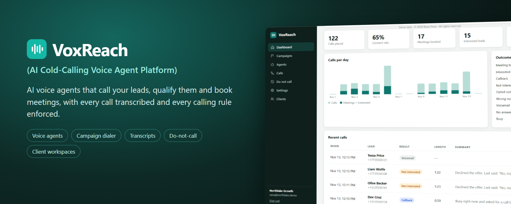

# VoxReach (AI Cold-Calling Voice Agent Platform)

**AI voice agents that call your leads, qualify them and book meetings.** You write the pitch and the qualifying questions; the agent makes the calls, handles objections, books the meeting or the call-back, and hands you a transcript and a result for every conversation. Calling rules such as consent, calling hours and do-not-call are enforced by the platform on every call, and each of your clients gets a private workspace.

> **This is a product showcase.** The VoxReach software and its source code are proprietary and are **not** included in this repository. See [License](#license).

**Showcase website:** https://rana537omar.github.io/voxreach-showcase/

## Demo video

<a href="https://rana537omar.github.io/voxreach-showcase/#demo">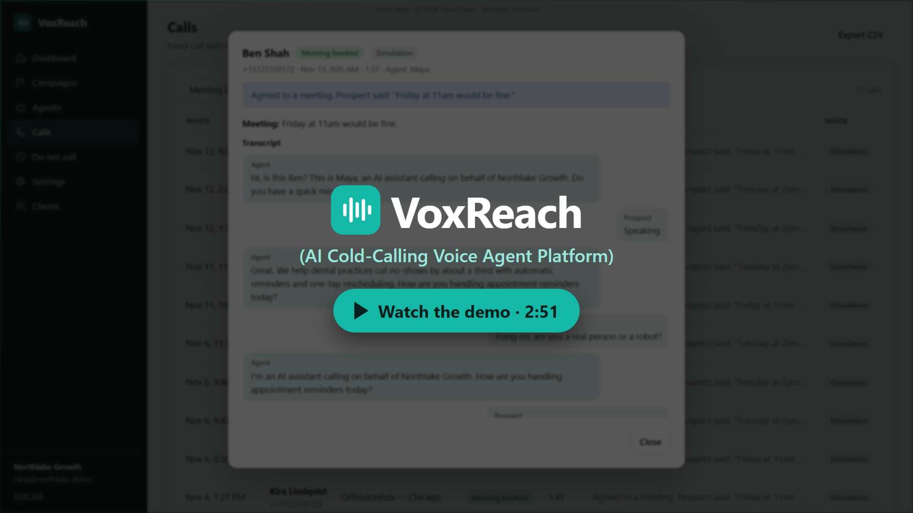</a>

A captioned walkthrough of 2 minutes 51 seconds, in 1080p. It opens on the dashboard, builds a voice agent and rehearses it in the browser, imports leads into a campaign and starts the dialer, then opens a finished call with its transcript. It ends with the do-not-call list, the calling rules, the AI and phone settings, and the client workspaces. The campaign in the video runs in the product's simulation mode with fictional leads; no real phone calls were placed. **[Watch it on the showcase website](https://rana537omar.github.io/voxreach-showcase/#demo)**.

## Features

### Voice agents
- **Built from your script**: a goal, an opening question, a pitch, qualifying questions, objection handling and booking instructions.
- **Rehearsal in the browser**: talk to the agent with your microphone or keyboard before it calls anyone, and see the result it would record.
- **Natural conversation**: connect the AI model you prefer, in the cloud or on your own server. Without one, a built-in scripted engine follows your script.
- **Hand-off to a person**: a prospect who asks for a human is transferred to the number you set.
- **Voice and language**: choose the language, voice provider and voice for live calls.

### Campaigns
- **CSV lead import** with name, phone, company, title, email, timezone, consent and notes.
- **Pacing controls**: calls at the same time and calls per minute, with start and pause.
- **Automatic retries** for no answer, busy and voicemail, with a cap on attempts per lead.
- **Live progress**: leads called, calls in progress, meetings booked and interested leads.
- **Simulation mode**: preview a campaign with scripted prospects before spending anything on calls.

### Every call on record
- **Transcript, result, summary and sentiment** for each call.
- **Results that matter to sales**: meeting booked, interested, call-back, not interested, wrong number, voicemail, no answer.
- **CSV export** and a **webhook** that sends each finished call to your CRM.

### Calling rules, enforced by the platform
- **AI disclosure**: every call opens by saying it is an AI assistant and who it is calling for. This cannot be switched off.
- **Consent gate**: leads without recorded consent are never dialled.
- **Calling hours and days** in each lead's own timezone.
- **Do-not-call list**: anyone who asks to stop is added automatically, and listed numbers are never dialled.

The platform enforces these rules, but the caller remains responsible for following the telemarketing law of the places they call.

### Built for agencies
- **Client workspaces**: each client gets its own agents, leads, calls, phone number and login. Data never crosses workspaces.
- **Team roles**: owners manage settings and people; members run campaigns.
- **Your own phone account**: live calls go out through your own phone number, so caller ID and call costs stay yours.
- **Runs on one small server** with its own database, and works on phones as well as desktops.

## Screenshots

### Dashboard and campaigns

| | |
|---|---|
| 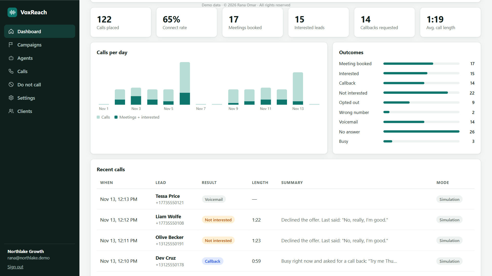 **Dashboard**: calls, connect rate, meetings and outcomes. | 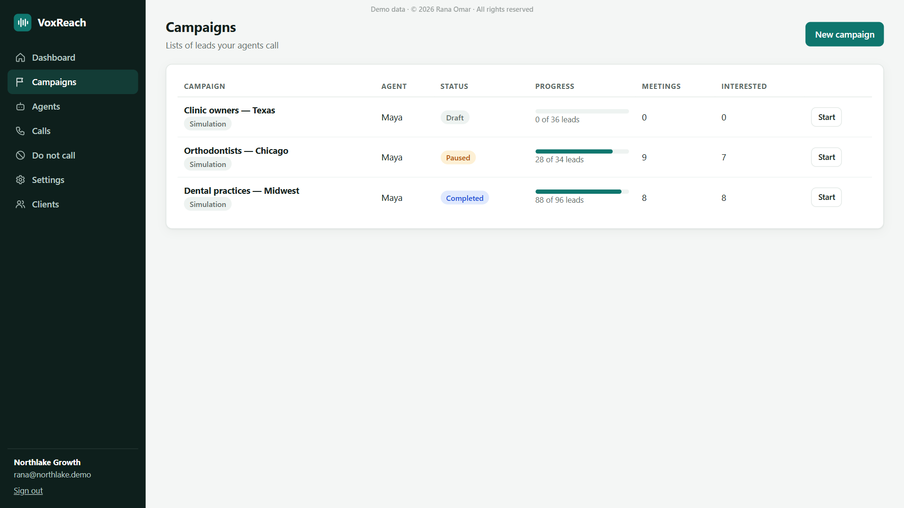 **Campaigns**: status and progress at a glance. |
| 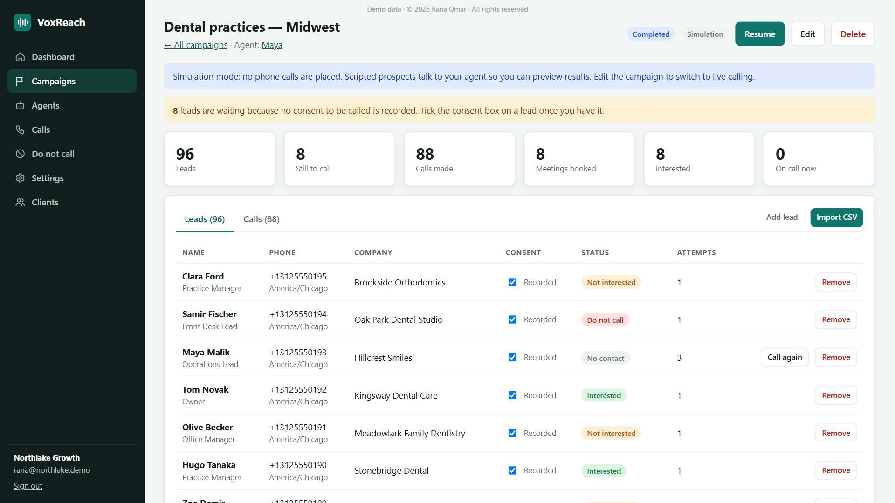 **Leads**: consent, status and attempts per lead. | 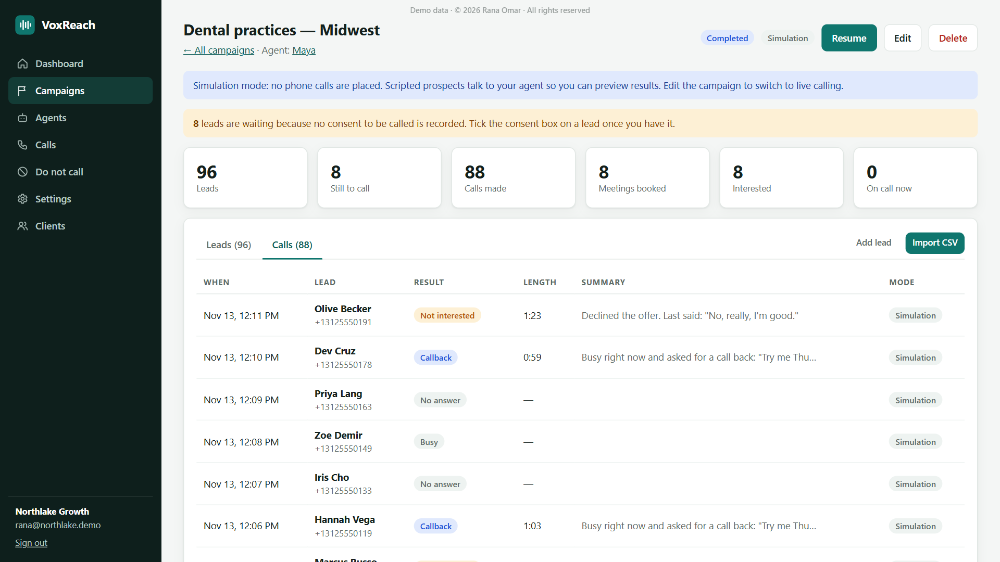 **Campaign calls**: results as they arrive. |

### Agents and calls

| | |
|---|---|
| 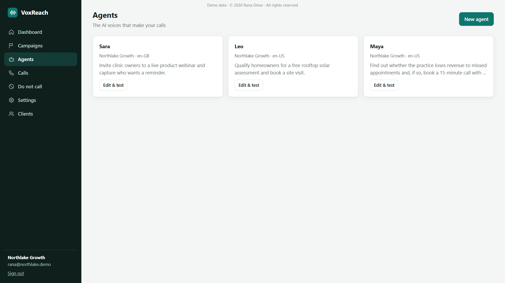 **Agents**: one for each offer. | 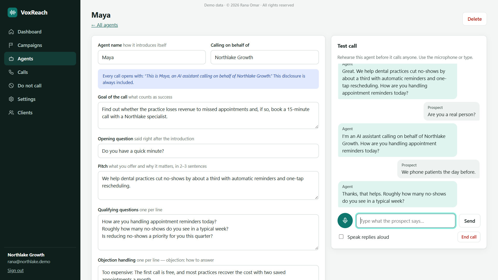 **Agent editor**: script on the left, a test call on the right. |
| 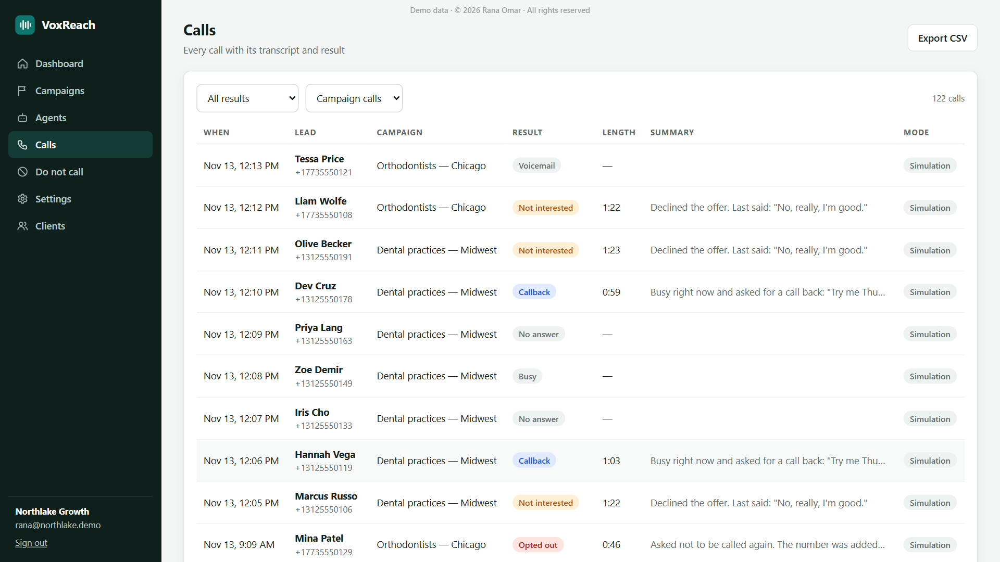 **Calls**: filter by result, export to CSV. | 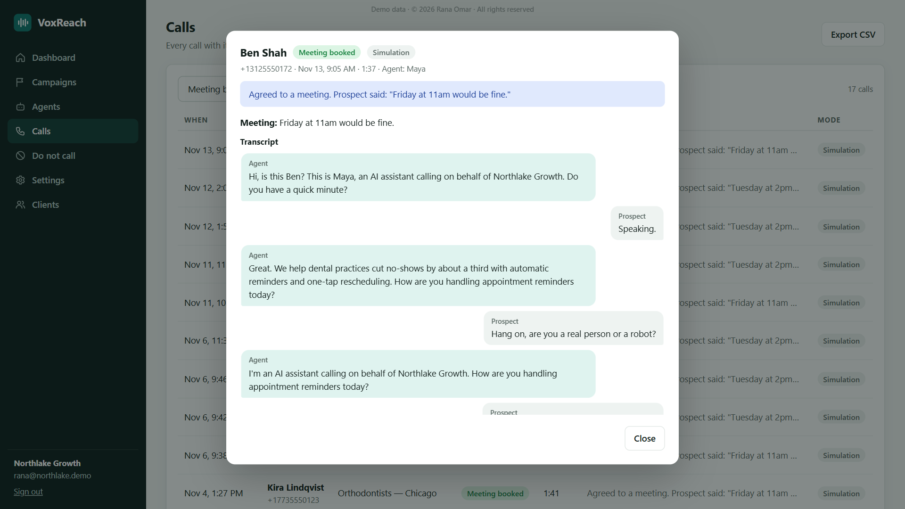 **Transcript**: the full conversation with its summary. |

### Rules, settings and clients

| | |
|---|---|
| 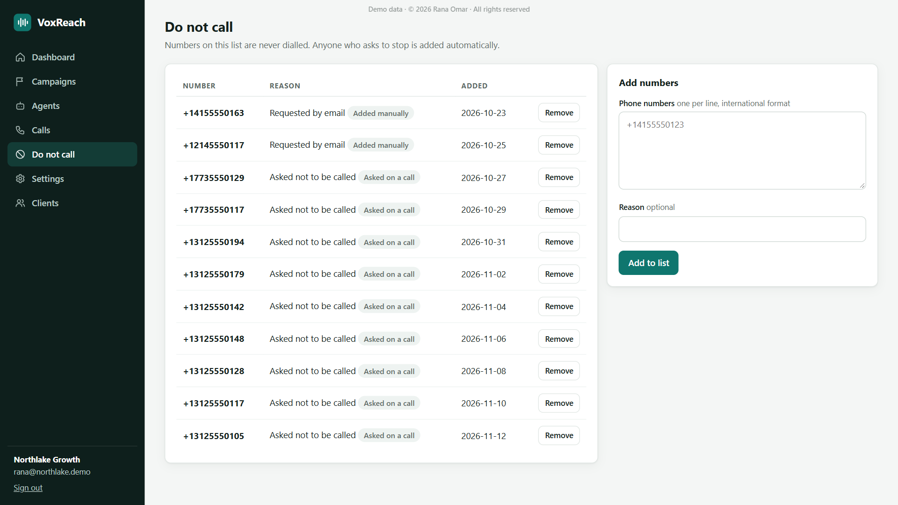 **Do not call**: opt-outs are added automatically. | 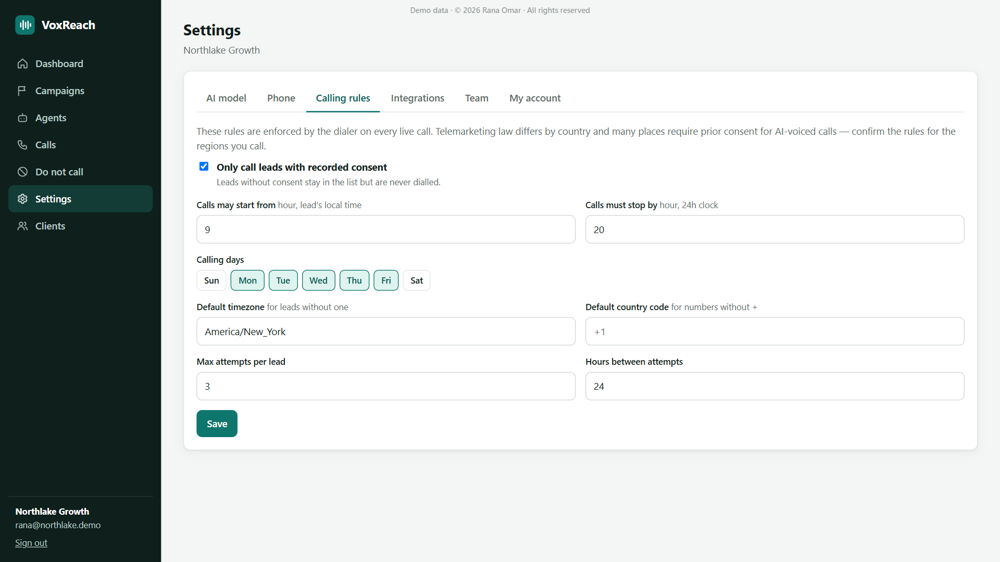 **Calling rules**: consent, hours, days and attempt limits. |
| 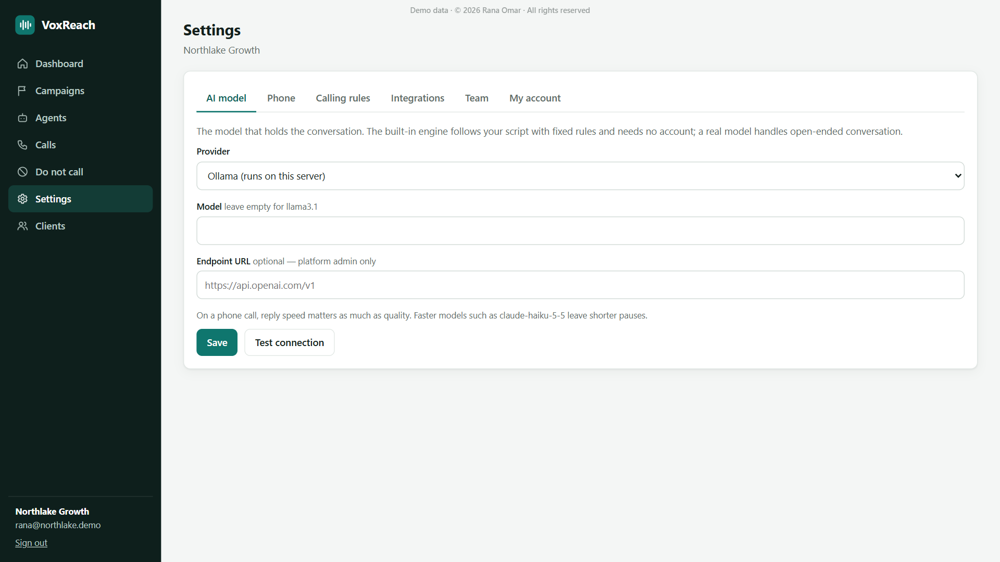 **AI model**: use the model you prefer. | 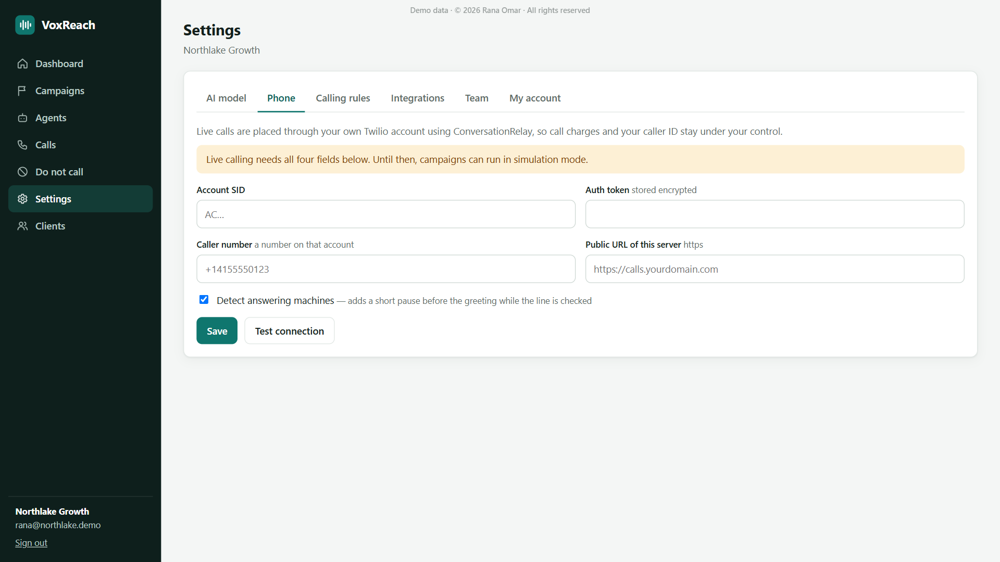 **Phone**: connect your own number for live calls. |
| 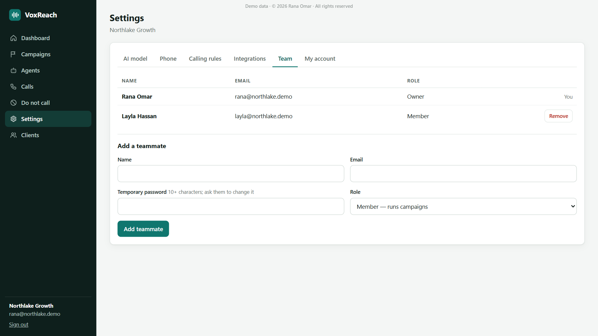 **Team**: owners and members. | 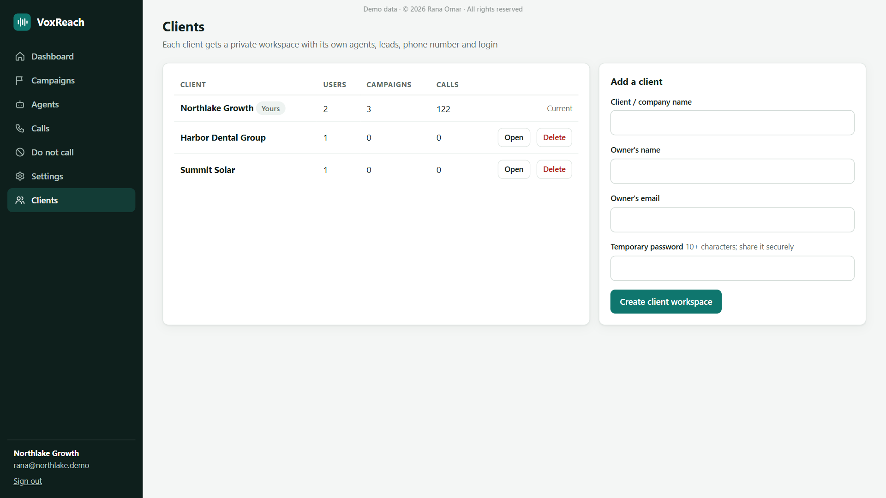 **Clients**: a private workspace for each one. |

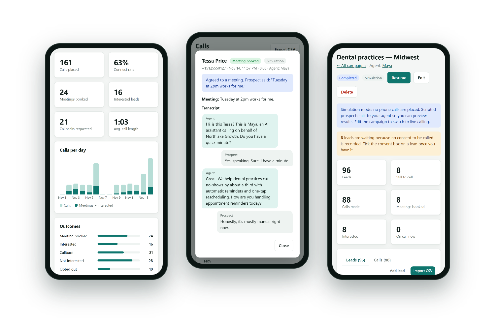

All names, companies, phone numbers, calls and figures in these screenshots and the video are fictional demo data produced in simulation mode. They are not real calls or real results.

## Get the full system

Want VoxReach for your sales team or agency, a live demo, or the complete source code? Message me on WhatsApp: **+20 120 856 2225**.

## License

**Copyright © 2026 Rana Omar. All rights reserved.** The text, screenshots, images and video in this repository are shared for viewing only. No license is granted to copy, reuse, modify, republish or use them, or the VoxReach software they show, for any personal or commercial purpose. See [LICENSE](LICENSE).
